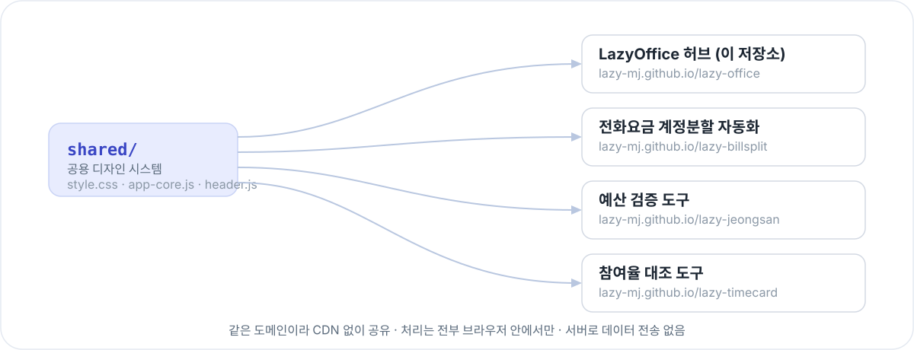

<p align="center">
  
</p>

<p align="center">
  <b>🌐 GitHub Pages에서 바로 사용</b> 👉 <a href="https://lazy-mj.github.io/lazy-office/"><b>lazy-mj.github.io/lazy-office</b></a>
</p>

---

## ✨ 지금 있는 도구

<p align="center">
  
</p>

- ✂️ **[전화요금 계정분할 자동화](https://lazy-mj.github.io/lazy-billsplit/)** — 부서별 전화요금을 계정번호별로 자동 분할·집계
- 💰 **[예산 검증 도구](https://lazy-mj.github.io/lazy-jeongsan/)** — PMS와 이지바로/RCMS 예산을 비목별로 자동 대조 (현재 협약사업만 지원, 기본사업은 지원 준비 중)
- 📅 **[참여율 대조 도구](https://lazy-mj.github.io/lazy-timecard/)** — PMS와 IRIS·RCMS 인건비 참여율을 사람별·월별로 자동 대조 (개발 중 · 테스트 버전)
  - IRIS는 참여연구자 엑셀, RCMS는 엑셀 다운로드가 안 돼서 화면 캡처를 브라우저 안에서 글자 인식
  - 실행계정이 여러 개로 나뉜 과제도 합산 대조, 여러 과제를 한 번에

## 🔒 개인정보 및 보안

이 홈페이지 자체는 파일을 다루지 않지만, 여기서 연결되는 모든 도구는 공통으로 다음 원칙을 따릅니다.

- 업로드한 파일은 서버로 전송되지 않고, 모든 처리는 브라우저 안에서만 이루어집니다.
- GitHub에는 사용자 데이터가 저장되지 않습니다.
- 결과 파일은 사용자의 PC로 직접 다운로드됩니다.
- 캡처 이미지 글자 인식(참여율 대조 도구의 RCMS)도 브라우저 안에서만 이루어지며, 이미지가 어디로도 전송되지 않습니다.

## 🧩 어떻게 동작하나요

<p align="center">
  
</p>

`shared/` 폴더 하나를 고치면 이를 참조하는 모든 도구(`lazy-billsplit`, `lazy-jeongsan`, `lazy-timecard` 등)에 동일하게 반영됩니다. 각 도구는 절대경로(`/lazy-office/shared/...`)로 이 폴더를 직접 불러오며, 전부 같은 도메인(`lazy-mj.github.io`)에 있어서 별도 CDN 없이 공유됩니다.

**기술 스택** — HTML5 / CSS3 / JavaScript (ES6+) · GitHub Pages 정적 배포 · 별도 프레임워크·빌드 과정 없음

## 📁 프로젝트 구조

``` text
lazy-office/
├── index.html          허브 홈페이지 (도구 카드 목록)
├── shared/
│   ├── style.css        공용 디자인 시스템 (색상, 카드, 스텝퍼, 모달, 버튼 등)
│   ├── app-core.js      공용 JS 유틸 (Toast, 확인/알림 모달, 진행표시, Storage, Drag&Drop 등)
│   ├── header.js        공용 헤더(로고·네비게이션)
│   ├── favicon.svg
│   ├── assets/          공용 이미지(마스코트 등)
│   └── vendor/          xlsx 라이브러리 등 외부 라이브러리
├── README.md
└── CHANGELOG.md
```

## 📌 버전

현재 버전: **v1.1** (변경 이력은 [CHANGELOG](./CHANGELOG.md))

## 💡 향후 계획

- 참여율 대조 도구 테스트를 마치면 정식 버전으로 ("개발 중" 표시 제거)
- 예산 검증 도구의 기본사업 지원 여부 검토
- 다른 도구의 결과 엑셀에도 테두리·색 서식 적용 검토 (참여율 대조 도구 방식)
- 자동화 모듈 추가 (각각 독립 저장소로 만든 뒤 이 홈페이지에 카드 연결)

## 📄 라이선스

본 프로젝트는 내부 업무 효율화를 목적으로 개발되었습니다. 필요에 따라
자유롭게 수정하여 사용할 수 있습니다.
